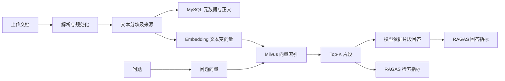

# 第四阶段学习文档：从文档到 RAG 质量评估

更新：2026-11-04。先阅读操作文档，亲手上传两份重复文件，再对照本篇读代码。项目位于 `E:\Project-xhb\ai-test`，以下代码路径均相对此目录。

## 1. 先理解要解决的问题

RAG 的意思是“先检索，再生成”。例如用户问保修期，程序先从制度中找相关段落，再把问题和段落交给模型回答。知识错误、检索遗漏、模型忽略证据都可能导致错误回答，所以本阶段分别检查知识本身、检索结果和生成结果。



上传和索引是两步。上传成功只说明能读取文本并保存，不说明 Milvus 已接收向量。这样缺外部服务时也能学习文档处理，并保留清楚的失败状态。

## 2. 技术在项目中的分工

| 技术 | 为什么使用、负责什么 | 主要代码 |
| --- | --- | --- |
| FastAPI / Pydantic | 提供 HTTP 接口，校验 JSON、数量、文件限制与权限 | `backend/app/api/v1/rag.py`、`schemas/platform.py` |
| PyMuPDF / python-docx | 提取 PDF、DOCX 真实文本，而非按扩展名伪造内容 | `backend/app/services/rag.py` |
| MySQL / SQLAlchemy | 保存关系、文档来源、问题与评估历史 | `backend/app/models/platform.py` |
| Alembic | 可重复升级表结构，避免手工建表不一致 | `backend/migrations/versions/0006_rag.py` |
| LangChain OpenAIEmbeddings | 统一调用兼容 Embedding 服务，把文字转成数字向量 | `services/rag.py` |
| Milvus | 按向量相似度检索片段 | `backend/app/integrations/milvus.py` |
| RAGAS | 实际执行检索与回答评估算法 | `backend/app/integrations/professional.py` |
| Vue / TypeScript | 上传、查看来源、确认问题、保存题集、查看逐题证据 | `frontend/src/views/Knowledge.vue` |
| Pytest / Playwright | 分别验证业务异常和真实浏览器工作流 | `backend/tests/test_rag.py`、`test_ragas_integration.py`、`frontend/tests/stage4.spec.ts` |

MySQL 和 Milvus 各有分工：MySQL 擅长“这个文档属于谁、处理到哪一步”，Milvus 擅长“哪些向量与问题相近”。MySQL 仍保留分块正文和来源，这样数据库记录、检索输出和质量证据能够对应。

## 3. 顺着一次上传读代码

前端 `Knowledge.vue` 读取用户选择的真实文件，转换为 Base64 交给 API。Base64 是传输编码，不是加密。

API 先通过 `kb_for_user` 检查知识库所属项目，防止其他账号访问。`kb_operation` 对同一知识库进行原子准入，在单进程中避免索引、删除、质量检测和评估互相穿插；忙碌时返回 409。锁的等待期间不会一直持有线程锁。

`parse_document(name, content)` 输入文件名和 Base64，输出原始字节及 `(页码, 文本)` 列表。PDF 保留真实页码；DOCX 提取段落和表格，逻辑页统一为 1。文件不合法、超限、非 UTF-8 或加密会返回 422。

`normalize(text)` 统一字符形式和空白。`chunks_from_pages(pages, size, overlap)` 则按字符数切块，输出带有页码、顺序的片段。重叠让跨边界的句子有机会保留下来，但也会增加索引体积。

比如长度 200、重叠 30 时，下一块从第 170 字符开始。重叠不能等于长度，否则步长为零。Pydantic 在接口入口拒绝这种配置。

数据库中的 `RagDocument` 保存状态、哈希和加密原始来源，`RagChunk` 保存正文及来源位置。哈希便于标识文档版本，不等于语义相同。

## 4. 索引和检索为何要校验状态

`embedding_client` 根据实际模型配置创建客户端；`embed` 调用真实服务并检查维度、有限数值和非零向量。`index_document` 按批写入 Milvus，成功后才把文档设为 indexed。

`retrieve` 的输入是问题、Top-K 和允许检索的文档 ID，输出是片段正文、相似度、文档名、页码和 chunk ID。查询先在 Milvus 内过滤已索引文档，避免失败文档的部分残留向量挤占 Top-K。

外部服务和 MySQL 不能做同一个数据库事务：Milvus 写了一半后断网，MySQL 回滚不能撤销外部写入。因此必须依靠状态过滤、按文档清理和重试。删除遇到向量清理失败会保留元数据，供用户继续排查。取消线程等待也不能保证外部请求立即停止，这不是跨服务“恰好一次”保证。

## 5. 质量检查如何避免误判

`quality_issues(chunks, documents)` 用规则找完全重复、近似、过短、异常字符和明确有效期等问题。它不调用模型。日期“2020 年会议记录”不代表文档已失效；只有明确有效期标签才能产生过期提示。

`semantic_pairs` 真正调用 Embedding，通过余弦相似度选跨文档候选；`judge_conflict` 再调用模型输出结构化事实、原因和建议。相似片段可能只是同一规则的不同说法，因此不能直接把相似度超过阈值当作冲突。模型可能判断错误，页面展示双方来源并允许人工确认或忽略。

为限制运行时间，规则近似只比较前 500 字符，每次检查最多 300 块，语义送审最多 20 对。这是一轮有范围的检查，不是全库完整证明。业务上应先拆分主题，再对重点库多次检查。

## 6. 问题集和评估如何留证据

`generate_questions` 在 `services/rag_evaluation.py` 中：取最多 30 块上下文，调用 RAG 用途模型，校验数量、不同问题、非空答案和合法来源。`RagDataset` 加密保存问题及原始响应；成功状态是 draft，必须在界面人工核对并保存，才能评估。失败也保留记录。

`run_evaluation` 的输入为已保存题集或直接问题列表（二选一）、模式、Top-K 及模型选择。它保存配置和文档哈希快照，每题先真实检索，再按模式生成答案及运行 RAGAS，输出逐题样本和运行状态。

| 指标 | 通俗问题 | 解释边界 |
| --- | --- | --- |
| Context Precision | 找来的片段中，有用内容是否排在前面？ | 需要问题、标准答案和检索上下文，不是普通分类准确率 |
| Context Recall | 标准答案需要的知识是否被找到了？ | 标准答案不完整也会影响解释 |
| Faithfulness | 回答中的说法能否从片段得到支持？ | 有证据不代表知识本身正确 |
| Answer Relevancy | 回答是否围绕问题？ | 相关不代表事实一定正确 |

分数范围 0–1，本项目对任一指标低于 0.7 提醒低质量。Answer Relevancy 当前 strictness=1，以控制调用量，质量实验应结合重复测量理解波动。缺配置、无命中、非有限分数或调用异常都不能补成满分或零分冒充真实评分。

样本在调用前就加入结果列表，拿到命中和答案后继续保留；后续评分失败不丢掉这些证据。每题隔离异常，整体最多 180 秒，超时或中断时保留已完成的部分。后端启动恢复会把仍在进行的记录标记失败，避免永远显示“运行中”。

## 7. 怎样调试与判断证据强度

先在浏览器按 F12 看 Network：请求路径是否为 `/api/v1/rag/...`，状态码是什么，响应错误码是什么；再查 `.local/backend.log` 中同时间请求。不要直接在日志打印密钥或完整敏感文件。

接口、数据库、外部服务分开排查：上传 422 看文件；409 看权限范围内的业务状态或模型配置；503 看 Milvus、模型连通性及维度。权限隔离通常表现为资源不存在，不应据此绕过归属校验。

运行 `.\scripts\check.ps1` 可做回归。本轮 107 个后端测试中，RAGAS 的三种模式实际执行库算法，但使用本地 OpenAI 协议测试服务回答，并不是实际模型。因此证据强度依次是：测试替身契约、真实 HTTP/MySQL 和浏览器、真实模型与 Milvus 联合验证。最后一层目前未通过。

依赖固定为 `ragas==0.4.3`、`langchain-community==0.4.1`、`pymupdf==1.27.2`、`python-docx==1.2.0`。0.4.2 的 community 移除了 RAGAS 当前依赖的入口，曾触发导入失败，已降至兼容 0.4.1 并补齐 dataclasses-json。安装记录命令：

```powershell
.venv\Scripts\python.exe scripts\run_module.py pip install --target runtime-packages --upgrade --no-deps langchain-community==0.4.1
.venv\Scripts\python.exe scripts\run_module.py pip install --target runtime-packages dataclasses-json==0.6.7
.venv\Scripts\python.exe scripts\run_module.py pip check
```

这是本机修复记录，日常不要反复执行覆盖包。新环境按锁文件安装；`backend/requirements.lock` 固定 147 个分发包。本机旧 community 元数据已可逆重命名为 `.dist-info.disabled`，避免重复版本识别。RAGAS 现有兼容包装 API 产生弃用警告，当前测试可运行，但未来升级前需要迁移 API 并重跑三种模式。不要看到 warning 就盲目升级全部依赖。

练习建议：先解释“解析成功为何不能检索”，再观察“普通旧日期为何不是过期”，最后补齐外部环境后对照同一问题的命中、回答与四项指标。每次只改变分块大小、Top-K 或模型中的一个变量，才容易知道结果变化的原因。
