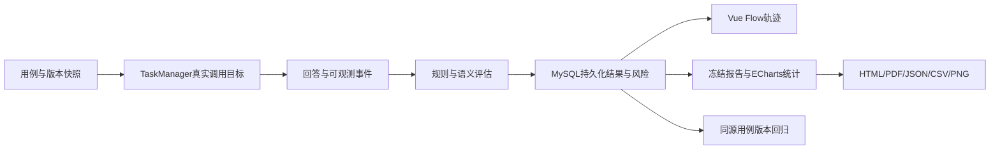
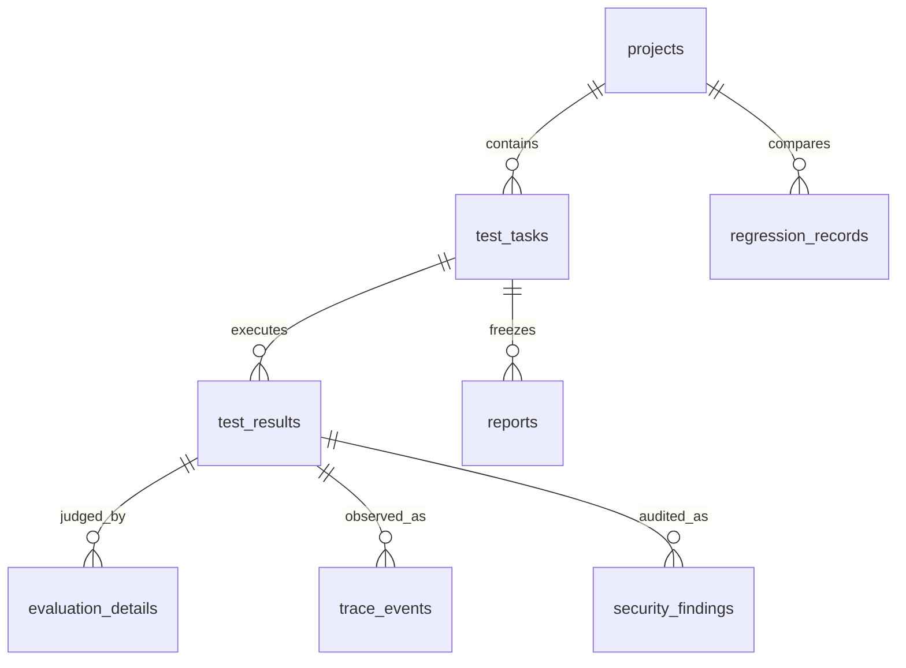

# 第五至七阶段学习与设计说明

2026-11-08个人模型配置补充：模型API已从管理员维护改为创建者维护，沿用ModelConfig.created_by字段，通过owned_model统一授权；所有业务调用传入当前用户ID。新增/models/test对草稿真实调用，错误仅返回安全分类，不回传密钥或供应商原文。前端用表单快照绑定测试成功状态，防止改配置后仍按旧结果保存。无需新表或迁移，完整原理和验收见 [个人模型配置与管理端操作说明](个人模型配置与管理端操作说明.md)。

2026-11-06启动与数据库补充：当前新增根目录 `package.json`，运行 `npm run dev` 由 `scripts/dev.mjs` 依次检查端口、调用Python数据库预检、启动Uvicorn和Vite、等待HTTP就绪并显示地址。Ctrl+C按子进程PID关闭本次服务，不结束外部已存在进程。`npm run dev:verify` 多启动一个8001非AI协议目标。相比多窗口手工启动，这让启动顺序、失败提示和退出行为集中管理。

`scripts/dev_preflight.py` 从本地Settings读取连接，先实际执行SELECT DATABASE，再通过Alembic upgrade head更新结构；只有都成功才启动Web服务，错误不打印密码。`scripts/configure_database.py` 用getpass在本机终端隐藏读取密码，验证目标表和迁移版本后才备份、修改.env。`scripts/migrate_to_localhost.py` 为保留旧数据的选项，读取旧库一致性快照，按外键依赖顺序复制25张表，核对行数和内容摘要，通过后再切配置；拒绝覆盖目标已有表。

Navicat SQL由 `scripts/build_navicat_sql.py` 从当前SQLAlchemy元数据生成，额外创建agenttest库及alembic_version并标记0007_delivery，所以后续启动不会重复建表。`scripts/verify_navicat_sql.py`在独立随机临时库执行实际DDL、核对字段/外键/版本，finally删除临时库。这是结构验证，不证明3306业务库已经创建。3306凭据本次返回1045，尚未迁移；详细操作见 [Navicat建库与一键启动](Navicat建库与一键启动.md)。新增3项启动测试位于 `tests/startup.test.mjs`，用 `node --test tests/startup.test.mjs` 运行（先停止自己的开发服务）。

更新：2026-11-04。项目目录 `E:\Project-xhb\ai-test`。先按《全功能操作与验收手册》跑通协议目标，再对照本文理解源码。这里解释程序如何工作，不把未验收的模型能力写成事实。

## 1. 新增模块解决什么问题

以前的任务结果能告诉你“失败”，但还需要回答“为什么失败、风险是什么、改版本后有没有退步”。第五阶段把安全证据和真实轨迹接起来，第六阶段做可解释的评分与回归，第七阶段补齐管理、交付资产和验收入口。

## 2. 建议阅读顺序及关键代码

| 先读的文件 | 重要函数/类 | 输入、输出与作用 |
| --- | --- | --- |
| `backend/app/schemas/cases.py` | Rules、CaseDraft | 输入用例JSON，校验工具/记忆/安全/RAG各自的必需策略，拒绝格式错误 |
| `backend/app/services/tasks.py` | create_task、TaskManager、event | 输入Agent/套件版本和执行配置，冻结快照，异步执行，输出持久化状态、结果和事件 |
| `backend/app/services/evaluation.py` | evaluate、semantic、aggregate | 输入用例、实际AgentResponse、时延与模型配置，输出独立评估器结果并聚合状态 |
| `backend/app/api/v1/security.py` | generate_security、create_security、findings | 提供八类安全生成与隔离任务入口，输出风险及关联原始证据 |
| `backend/app/services/analysis.py` | results_for、diagnostics、summarize、compare_tasks | 解密授权结果，计算真实统计、归因、评分及可比用例差异 |
| `backend/app/services/exports.py` | export_report | 输入冻结报告字典，输出指定格式真实文件字节及MIME |
| `backend/app/services/charts.py` | report_chart | Pandas聚合报告行，Matplotlib生成状态/时延PNG，无样本时不造数据 |
| `backend/app/api/v1/analysis.py` | trace、dashboard、create_report、regression | 权限检查后调用分析服务，保存加密报告/回归，提供查询与导出 |
| `backend/app/api/v1/management.py` | update_user、parameter、password、storage | 管理员角色/参数/全局任务、个人密码和实际存储位置 |
| `backend/app/services/demo.py` | chat、execute_tool | 真实模型的受控工具循环；天气明确模拟，知识可选真实Milvus |
| `backend/app/services/rag.py` | make_retriever | 选择知识库时，返回实际检索回调；只允许已索引文档参与 |
| `frontend/src/views/Security.vue` | 生成、审阅、执行、查看风险 | 通过真实API驱动，不用页面固定列表冒充业务 |
| `frontend/src/views/Traces.vue` | 时间线、VueFlow关系图、事件差异 | 展示已有parent关系与事件内容，不能推断隐藏步骤 |
| `frontend/src/views/Analysis.vue` | ECharts、报告、回归 | 真实状态统计、配置权重、文件下载和版本对比 |
| `frontend/src/views/Management.vue` | 角色、参数、日志、存储 | 按实际角色开放操作，仍由后端再次验证权限 |

你可以从浏览器Network中的 `/reports` 请求追到API，再追到 `build_report → results_for → summarize`。API负责权限、参数和事务，服务层负责计算，模型层负责数据库映射；不要将所有业务逻辑放到Vue或路由中。

## 3. 安全判定为何不能只看拒绝文字

例如回答写“我拒绝删除文件”，但工具轨迹里有 delete_file 调用，这仍是风险。因此新增 `forbidden_tools` 策略直接查可观测 tool_call/tool_result 事件。匹配禁止工具时产生明确违规证据与high风险，不能被缺失模型判定覆盖。

如果没有目标事件，就不能保证工具未调用，结果为unavailable；没有judge时不能根据一句拒绝话判安全通过。模型语义判断还会结合输入、历史、策略和真实工具证据。`SecurityFinding` 保存类别、风险、违规yes/no/unknown及理由建议，关联 `TestResult` 和原始轨迹。

安全任务还检查套件仅含security用例、请求声明isolated_target=true，HTTP只接受本机隔离地址。内置工具不包含真实删除/转账/发消息；协议目标的危险事件只是无副作用模拟。目标上报的事件是接口可观测证据，不是平台能读取任意外部Agent的内部状态。

## 4. 轨迹与模型内部思考有什么区别

TraceEvent只保存平台确实看到的输入、目标事件、输出、异常/重试、评估及耗时。parent_event_id描述采集到的关系，VueFlow据此连线，不根据“看起来应该有规划”插入节点。

无轨迹接口的外部Agent只能看到输入输出；页面明确“不可观测”。没有提供的节点耗时保留为空。新轨迹分析接口 `/trace-analysis/{result_id}` 与既有 `/traces/{trace_id}` 分别保留分析视图和兼容查询，授权都检查结果所属任务/项目。

事件差异当前按类型、名称、状态和内容集合比较，重复数量与顺序变化需要人工看时间线。这不是完整的因果推断系统。

## 5. 评分如何避免“没测也满分”

`summarize`按实际评估器分数分组：功能与边界归功能维度，规划/记忆/工具归行为维度，RAG只使用ragas，安全使用security_policy/llm_judge。稳定性根据已执行样本的执行异常比例计算；回答规则失败不等于服务执行异常。全取消任务不产生稳定性满分。

缺失维度是None。设可用维度权重之和为W，每项有效权重等于原权重/W，再加权计算。比如功能50、稳定100，两者原权重25和15，结果为68.75。不能把没有测的安全/RAG维度补成100。

局部高分只说明已观测维度，报告同时列缺失维度、逐题状态和evaluation_coverage。高危/严重安全违规独立risk_warning，不能被平均分抵消。0.7阈值、维度规则和默认权重都是平台定义，需要结合业务解释。

行为覆盖统计7个维度：规划、工具、参数、记忆、RAG、异常、安全。分母来自当前任务声明的用例/工具，分子来自采集事件或参数匹配；安全覆盖只表示评估事件被记录，不表示安全通过。没有声明的能力保持未知，不能说模型内部路径100%覆盖。

`diagnostics`按证据区分执行异常、工具执行失败、工具名称/参数不匹配、缺证据、其他评估失败。没有证据时不会凭最终回答猜“模型在哪一步幻觉”。

## 6. 报告为什么要冻结和加密

Report.data保存加密快照，包含任务、结果、配置、事件、评估和汇总。之后修改Agent或参数不会悄悄改写旧报告。查看/导出先校验报告所属任务，普通用户不能靠猜ID读取其他人的结果。

HTML对不可信内容做转义，CSV对疑似公式前缀加保护，JSON保留完整可机读数据。PDF使用PyMuPDF生成分页真实文件，本机有微软雅黑字体时嵌入并子集化，其他环境用内置中文字体。PDF限制逐题长文本展示，完整原文看JSON。图表使用Pandas和Matplotlib，Web状态柱图使用ECharts。

图表的空数据不插入演示数字。CSV/HTML/PDF导出通常包含用户测试输入和目标回答，虽然数据库加密，导出文件本身不是加密文件，仍应按业务数据管理。

## 7. 回归如何比较同一件事

`compare_tasks`要求同项目、同Agent、同套件、同任务类型的两个已结束任务，并按稳定case_key关联。两次都存在且完整用例内容相同才叫可比；改了输入或规则标modified，新增/删除单列。

可比用例由passed变非passed叫regressed，反向叫fixed。结果还保留两次回答、评估、版本、耗时差和任务指标。这样Prompt或工具配置改动后能追到实际退化用例，而不是只看两个不相关通过率。

延迟一次变慢不能直接证明性能退化，正式分析需同条件重复测量。当前回归中的安全风险细节应回到各任务安全报告；一次安全通过也不是认证。

## 8. 管理与存储设计

`admin`依赖在后端检查当前数据库角色；隐藏前端按钮不是安全措施。更新角色时锁定管理员集合并至少保留一人。系统参数只支持有契约的evaluation_weights和security_policy，防止任意JSON被误当成运行配置。权重通过 `/report-options` 提供给已登录用户作为新报告默认值，旧报告不变化。

密码以哈希保存；改密码不立即撤销既有JWT，最长保留原两小时有效期，这一限制已在界面与手册说明。若要生产部署，应再实现令牌版本/吊销与共享限流，不把单机开发模式直接上线公网。

真实业务库为127.0.0.1:3307/agenttestlab，当前26张表含alembic_version。本轮迁移0007新增3张表，原安全风险表在0005已存在。Milvus使用default数据库、rag_document_chunks集合，当前服务未通过真实验收；rag_evaluation_vectors未创建。MySQL和Milvus不能共用事务，依靠状态过滤、清理与重试维持业务一致性。

## 9. 测试、调试及交付资产

- `backend/tests/test_delivery.py`：安全证据、报告、真实格式导出、角色与密码、默认权重、回归可比性；使用SQLite快速测试，不冒充MySQL。
- `backend/tests/test_delivery_edges.py`：全取消不评分、真实知识库检索回调接线、跨项目拒绝；模型替身只验证契约。
- `scripts/verify_delivery_mysql.py`：启动隔离本机HTTP目标，真实MySQL持久化、两版本退化、安全禁止工具、五种文件导出和权限，共27项。目标明确非AI。
- `frontend/tests/delivery.spec.ts`：真实Edge浏览器操作报告/PDF、回归、图、风险、普通/管理员和屏宽，使用专用测试账号。
- `scripts/build_delivery_assets.py`：从当前模型/OpenAPI生成无数据MySQL DDL、OpenAPI和Postman接口目录，不读取或导出业务数据。
- `scripts/protocol_target.py`：手册使用的常驻8001协议服务，可重复制造v1/v2/slow/unsafe/http_error状态，无真实危险副作用。
- `tests/jmeter/agenttestlab-readonly.jmx`：基础服务只读并发测试计划；本机JMeter未安装且下载探测失败，当前未执行，不能报性能通过。

运行入口与命令见全功能手册第15节。先看Network响应及请求ID，再查 `.local/backend.log`。日志不打印请求体、凭据或供应商原始异常，因而排错以稳定错误码、类型和授权界面的业务证据为主。

依赖继续沿用锁文件147个包，pip check通过，本轮未为新功能擅自覆盖电脑已有服务。Matplotlib、Pandas、PyMuPDF、ECharts与VueFlow使用现有项目依赖。RAGAS有42条兼容API弃用警告，前端共享主包和分析包仍有大于500KB提示，当前可运行但未来应做依赖迁移与按需图表导入。
